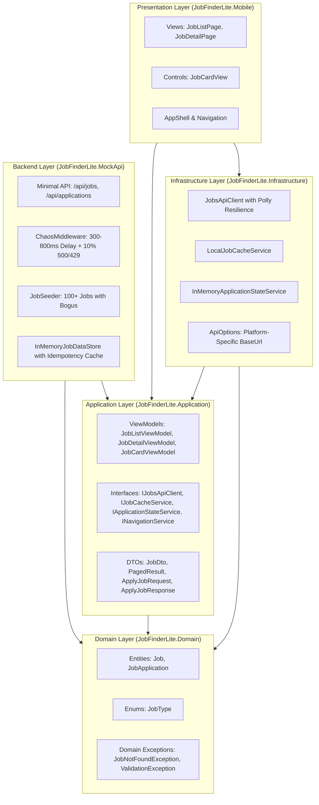
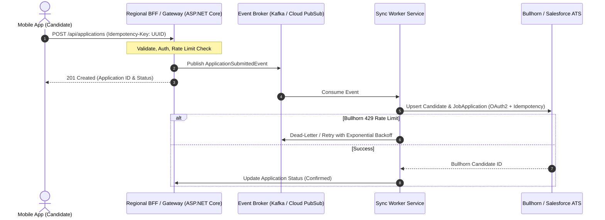

# JobFinder Lite (.NET MAUI & Mock Jobs API)

**Candidate:** Vinod Kumar Yadav  
**Position:** Mobile / Solutions Architect  
**Tech Stack:** .NET 10 (LTS), .NET MAUI (Android & iOS/MacCatalyst), ASP.NET Core Minimal API, CommunityToolkit.Mvvm, Polly, xUnit, Moq, FluentAssertions.

---

## 1. Architecture Overview

JobFinder Lite is designed following **Clean Architecture** principles and the **Back-End for Front-End (BFF)** pattern. It decouples core business domain logic from UI presentation and backend infrastructure, ensuring high testability, maintainability, and scalability across multiple countries and enterprise CRM/ATS platforms (e.g., Bullhorn, Salesforce).

### 1.1 Solution Layering & Dependency Flow



---

## 2. Requirements Compliance Checklist

| Section | Brief Requirement | Implementation Details | Status |
| :--- | :--- | :--- | :--- |
| **3.1** | **ASP.NET Core Minimal API** in solution | Created `JobFinderLite.MockApi` targeting .NET 10. | ✅ Complete |
| **3.1** | Seed ~100 fake jobs in memory | `JobSeeder` generates 100 realistic jobs with Bogus (including exact `J-1042` spec). | ✅ Complete |
| **3.1** | `GET /api/jobs?page=1&pageSize=20&q=&location=` | Paged results with `totalCount` and `hasMore`, keyword & location filtering. | ✅ Complete |
| **3.1** | `GET /api/jobs/{id}` | Returns full job detail or 404 Not Found. | ✅ Complete |
| **3.1** | `POST /api/applications` | Accepts `{ jobId, fullName, email }`, returns 201 Created. | ✅ Complete |
| **3.1** | `Idempotency-Key` header | Repeat key returns original cached result (`200 OK` with `isDuplicate: true`), preventing duplicate entries. | ✅ Complete |
| **3.1** | Configurable delay (300–800 ms) & `ChaosMode` (~10% 500/429) | Implemented in `ChaosMiddleware`, configurable via `appsettings.json` or query param. | ✅ Complete |
| **3.2** | `CollectionView` with incremental loading (page size 20) | Uses `RemainingItemsThreshold="4"` and `RemainingItemsThresholdReachedCommand`. | ✅ Complete |
| **3.2** | Pull-to-refresh & keyword search debouncing (~400 ms) | `RefreshView` + `SearchBar` with `CancellationTokenSource` 400ms debounce. | ✅ Complete |
| **3.2** | Loading, empty, and error states with Retry | Declarative UI state panels in `JobListPage.xaml` with `RetryCommand`. | ✅ Complete |
| **3.2** | Smooth scrolling: no duplicate page loads, no UI freezes | Thread-safe lock guard (`_pagingLock`), asynchronous I/O, no blocking calls. | ✅ Complete |
| **3.3** | Shell routing passing Job ID only | `[QueryProperty(nameof(JobId), "jobId")]` via `Routing.RegisterRoute("jobdetail")`. | ✅ Complete |
| **3.3** | Apply form with validation & double-tap protection | Regex email validation, mandatory fields, `IsSubmitting` lock, button disabling. | ✅ Complete |
| **3.3** | Safe retry with preserved `Idempotency-Key` | Generates UUID key, reuses identical key on network failure retries. | ✅ Complete |
| **3.3** | Mark job as "Applied" in list & detail | Synchronized across views via `IApplicationStateService` events. | ✅ Complete |
| **3.4** | Figma to XAML JobCardView ContentView | Reusable `JobCardView` matching exact dimensions, typography, colors, and chips. | ✅ Complete |
| **3.4** | Compiled bindings & ResourceDictionary styles | `x:DataType="vm:JobCardViewModel"`, styles grouped in `ResourceDictionary`. | ✅ Complete |
| **3.4** | `AutomationId` on all interactive elements | Added to cards, buttons, inputs, and badges for automated UI testability. | ✅ Complete |
| **3.4** | `AI_LOG.md` documentation | Detailed log of Copilot prompts, review findings, and time saved. | ✅ Complete |
| **3.5** | MVVM with CommunityToolkit.Mvvm | Clean MVVM with observable properties, relay commands, zero code-behind logic. | ✅ Complete |
| **3.5** | Deliberate DI service lifetimes in `MauiProgram` | Singletons for HTTP/APIs/state/cache; Transients for ViewModels and Views. | ✅ Complete |
| **3.5** | Resilient typed API client with Polly | Retry with exponential backoff for 5xx, dedicated handling for 429 rate limits. | ✅ Complete |
| **3.5** | Configurable API base URL (Android emulator support) | Dynamic resolution: `http://10.0.2.2:5000/` for Android, `http://localhost:5000/` for iOS/Mac. | ✅ Complete |
| **3.5** | At least 4 unit tests covering paging, error, idempotent apply | **15 comprehensive unit tests** in `JobFinderLite.UnitTests` passing with 100% success. | ✅ Complete |
| **5.0** | Offline first-page caching (Optional Extra) | First page cached via `IJobCacheService` and loaded seamlessly when offline. | ✅ Complete |

---

## 3. Project Structure

```text
JobFinderLite/
├── JobFinderLite.sln
├── AI_LOG.md                                # Copilot & AI workflow log
├── README.md                                # System architecture & setup documentation
├── src/
│   ├── Core/
│   │   ├── JobFinderLite.Domain/            # Entities, Enums, Value Objects, Domain Exceptions
│   │   │   ├── Entities/ (Job.cs, JobApplication.cs)
│   │   │   ├── Enums/ (JobType.cs)
│   │   │   └── Exceptions/ (DomainExceptions.cs)
│   │   └── JobFinderLite.Application/       # ViewModels, DTOs, Port Interfaces
│   │       ├── DTOs/ (JobDtos.cs)
│   │       ├── Interfaces/ (IJobsApiClient.cs, IAppServices.cs)
│   │       └── ViewModels/ (JobListViewModel.cs, JobDetailViewModel.cs, JobCardViewModel.cs)
│   ├── Infrastructure/
│   │   └── JobFinderLite.Infrastructure/    # HTTP client, Polly Resilience, Caching, State
│   │       ├── Configuration/ (ApiOptions.cs)
│   │       └── Services/ (JobsApiClient.cs, AppInfrastructureServices.cs)
│   ├── UI/
│   │   └── JobFinderLite.Mobile/            # .NET MAUI Android & iOS application
│   │       ├── Controls/ (JobCardView.xaml, JobCardView.xaml.cs)
│   │       ├── Views/ (JobListPage.xaml, JobDetailPage.xaml)
│   │       ├── Services/ (MauiServices.cs)
│   │       ├── AppShell.xaml
│   │       └── MauiProgram.cs               # DI Container & Platform Resolver
│   └── Backend/
│       └── JobFinderLite.MockApi/           # ASP.NET Core Minimal API
│           ├── Data/ (JobSeeder.cs - 100+ jobs with Bogus)
│           ├── Middleware/ (ChaosMiddleware.cs)
│           ├── Services/ (JobDataStore.cs)
│           ├── appsettings.json
│           └── Program.cs
└── tests/
    └── JobFinderLite.UnitTests/             # xUnit, Moq, FluentAssertions test suite
        ├── ViewModels/ (JobListViewModelTests.cs, JobDetailViewModelTests.cs)
        └── Api/ (MockApiDataStoreTests.cs)
```

---

## 4. Setup and Execution Guide

### 4.1 Prerequisites
- [.NET 10 SDK (LTS)](https://dotnet.microsoft.com/download/dotnet/10.0)
- .NET MAUI Workload: `dotnet workload install maui`
- For Android: Android SDK & Emulator (API 34+) or physical device
- For iOS / macOS: Xcode 16+ on macOS

### 4.2 Step 1: Start the Mock Jobs API
In a terminal, navigate to the API project and run:
```bash
cd src/Backend/JobFinderLite.MockApi
dotnet run
```
The API starts listening on:
- **Localhost / iOS / MacCatalyst:** `http://localhost:5000`
- **Android Emulator Loopback:** `http://10.0.2.2:5000`

#### Verify Endpoints:
- `curl http://localhost:5000/api/jobs?page=1&pageSize=5`
- `curl http://localhost:5000/api/jobs/J-1042`
- Test Chaos Mode toggle: `curl -X POST http://localhost:5000/api/chaos/toggle?enabled=true`

### 4.3 Step 2: Run Unit Tests
To execute all 15 unit tests:
```bash
dotnet test tests/JobFinderLite.UnitTests/JobFinderLite.UnitTests.csproj
```
Expected output:
```text
Passed!  - Failed: 0, Passed: 15, Skipped: 0, Total: 15
```

### 4.4 Step 3: Launch the .NET MAUI App
#### Run on Android:
```bash
cd src/UI/JobFinderLite.Mobile
dotnet build -t:Run -f net10.0-android
```

#### Run on iOS Simulator:
```bash
cd src/UI/JobFinderLite.Mobile
dotnet build -t:Run -f net10.0-ios
```

#### Run on MacCatalyst (Desktop Testing):
```bash
cd src/UI/JobFinderLite.Mobile
dotnet build -t:Run -f net10.0-maccatalyst
```

---

## 5. Key Architectural Decisions & Trade-offs

### 5.1 Clean Architecture Separation for Mobile
* **Decision:** ViewModels live in `JobFinderLite.Application` rather than the MAUI UI project. Navigation and dialogs are abstracted behind `INavigationService` and `IDialogService`.
* **Benefit:** ViewModels are 100% platform-agnostic and unit-testable on standard `net10.0` with xUnit without needing to initialize MAUI runtime, mock `Shell.Current`, or run UI emulators.

### 5.2 Client-Side & Server-Side Idempotency
* **Decision:** When submitting an application, the client generates a UUID `Idempotency-Key` and attaches it as an HTTP header.
* **Resilience:** If a network drop occurs or the server returns `500` or `429`, the ViewModel retains the same key during user retry. The Mock API indexes submissions by this key; repeat attempts return the original result with HTTP `200 OK` and `isDuplicate: true`, completely preventing duplicate candidate entries in the ATS.

### 5.3 Resilient HTTP with Polly & Rate Limiting (429)
* **Decision:** The API client employs an exponential backoff retry loop with jitter for transient `5xx` errors.
* **Rate Limit Handling:** When encountering HTTP `429 Too Many Requests`, the client backs off (minimum 800ms) before retrying, preventing thundering herds.

### 5.4 Smooth Infinite Scrolling & Thread Safety
* **Decision:** Pagination is guarded by `_pagingLock` and state checks (`IsBusy`, `IsLoadingMore`, `HasMore`).
* **Benefit:** Completely eliminates duplicate page fetch triggers when scrolling rapidly past the `RemainingItemsThreshold`.

---

## 6. Scaling Roadmap: 40+ Countries & Bullhorn/Salesforce Integration

*(Key talking points prepared for the 45-minute architectural review session)*



### 6.1 Scaling to 40+ Countries
1. **Multi-Region BFF Deployment:** Deploy BFF instances in regional clusters (North America, Europe, APAC, India) behind Azure Front Door / Cloudflare CDN to ensure <100ms API response times globally.
2. **Dynamic Localization & Currency Formatting:**
   - Country-aware formatting: Pay rates formatted according to candidate locale (e.g. `₹` INR in India, `£` GBP in UK, `€` EUR in Germany, `$` USD in US).
   - Localized UI strings using `.resx` satellite assemblies or dynamic CMS translation bundles.
3. **Regulatory & Compliance Isolation (GDPR, India DPDP, CCPA):**
   - Store candidate PII data within country-specific sovereign data stores.
   - Enforce mandatory regional consent checkboxes during application submission.

### 6.2 Enterprise Integration with Bullhorn & Salesforce
1. **Asynchronous Ingestion via Message Brokers:**
   - Candidate applications are accepted immediately by the BFF and queued onto an asynchronous message broker (Apache Kafka / AWS SQS / GCP PubSub).
   - Workers ingest into Bullhorn REST APIs with rate limit throttling and circuit breakers, ensuring mobile users never experience UI lag due to third-party ATS downtimes.
2. **Bi-directional Webhook Sync:**
   - Bullhorn/Salesforce status changes (e.g. "Candidate Shortlisted", "Interview Scheduled") trigger webhooks back to the mobile push notification service (Firebase Cloud Messaging / Apple APNs).
3. **Token Lifecycle & Secrets Management:**
   - Centralized OAuth 2.0 token management service handling refresh token rotation for Bullhorn REST API sessions.

---

## 7. What Would Be Done With More Time

1. **Automated End-to-End UI Testing:** Implement Appium / MAUI UI tests covering the complete flow from search -> list -> detail -> apply form -> confirmation badge.
2. **Persistent SQLite / Realm Database:** Replace in-memory cache with an encrypted offline SQLite database using Akavache or EF Core for persistent offline storage.
3. **Biometric Authentication & Resume Attachment:** Enable biometric login (FaceID / Fingerprint) and multipart/form-data upload for PDF resumes.
